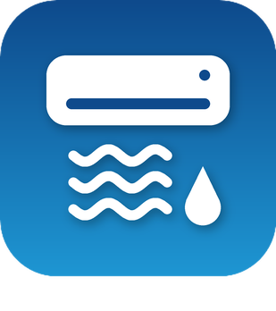

# Plugin Jeedom Midea MSmart (`mideamsmart`)



Pilotage **local** des climatiseurs et déshumidificateurs Midea et des marques associées (Comfee, Inventor, Qlima…) compatibles avec l'application **MSmartHome**, pour [Jeedom](https://www.jeedom.com) 4.5 et plus.

*English summary below.*

## Fonctionnalités

- **Synchronisation** des appareils du compte MSmartHome et recherche sur le réseau local, avec création automatique des équipements.
- **Clés V3** (*token* et *key*) récupérées une seule fois sur le cloud, puis **vérifiées auprès de l'appareil**. Tout le pilotage se fait ensuite en local, sans cloud.
- **Commandes créées selon les capacités** de chaque appareil : mode, consigne, ventilation, oscillation, préréglages (éco, turbo, nuit, hors-gel…), Breeze, humidité, réservoir, consommation électrique…
- Appareils pris en charge :

  | Type | Appareil | Bibliothèque |
  |---|---|---|
  | `0xAC` | Climatiseur | [msmart-ng](https://github.com/mill1000/midea-msmart) |
  | `0xCC` | Climatiseur commercial | [msmart-ng](https://github.com/mill1000/midea-msmart) |
  | `0xA1` | Déshumidificateur | [midea-local](https://github.com/midea-lan/midea-local) |

- **Programmation** horaire intégrée : profils communs à tous les appareils (par exemple *Normal* et *Vacances*), créneaux propres à chaque appareil, bascule de profil par une commande de scénario, rattrapage du dernier créneau passé.
- **Fiabilité** :
  - appareil hors ligne signalé, avec interrogations espacées ;
  - adresse IP retrouvée automatiquement après un changement ;
  - protection du compte contre les blocages du cloud Midea (`7610`, `65027`) ;
  - fenêtre de diagnostic avec copie pour le forum.
- **Python 3.13 autonome**, installé avec [uv](https://github.com/astral-sh/uv) dans un environnement virtuel propre au plugin, sans toucher au Python du système.
- Interface et documentation en français, anglais, espagnol, italien, russe, portugais et allemand.

 

## Installation

Le plugin s'installe depuis le Market Jeedom. La documentation complète est dans [`docs/fr_FR/index.md`](docs/fr_FR/index.md) et les nouveautés dans [`docs/fr_FR/changelog.md`](docs/fr_FR/changelog.md).

Prérequis :
- Jeedom 4.5+ sur Debian 12 ou 13 (amd64, arm64 ou armhf) ;
- appareils sur le même réseau local que Jeedom ;
- pour les appareils V3, un compte MSmartHome sur lequel ils sont **appairés directement** (un simple partage ne suffit pas).

> **Version bêta** : le plugin est testé avec des appareils simulés, mais pas encore avec tous les modèles réels. Vos retours sont les bienvenus sur le [forum Jeedom](https://community.jeedom.com). Joignez le résumé produit par le bouton **Diagnostic** de l'équipement.

## Développement

```
core/            classe PHP, ajax, callback du démon, définitions des commandes (config/commands.json), traductions (i18n)
desktop/         page du plugin, JS, fenêtre de diagnostic, images
plugin_info/     info.json, configuration, installation, icône
resources/       script d'installation des dépendances, versions verrouillées, démon Python (mideamsmartd/)
docs/            documentation et changelog en 7 langues, captures
tools/           outils de développement (traductions, icônes, lock, faux appareils, captures)
PROJECT.md       décisions et notes de conception
```

- Tests du démon (unitaires et intégration avec les vraies bibliothèques contre des appareils simulés) :
  ```
  cd resources/mideamsmartd && <venv>/bin/python3 -m unittest discover -s tests -t .
  ```
- Faux appareils LAN pour tester sans matériel : `tools/fake_device.py --type ac|a1`.
- Traductions : `tools/i18n.py check|update`. Versions Python : `resources/requirements.in`, puis `tools/lock_requirements.sh`.
- Le code PHP doit rester compatible PHP 7.4 à 8.2, et le JS utilise les API vanilla du core 4.4+.

## English summary

Local control of Midea air conditioners (`0xAC`, `0xCC`) and dehumidifiers (`0xA1`) for Jeedom 4.5+. The MSmartHome account is only used to list the appliances and retrieve, once, the V3 keys, which are checked with the appliance. Then everything runs on the local network. Commands are created from the capabilities of each appliance. A built-in schedule uses profiles shared by all the appliances (e.g. Normal and Holidays) and slots specific to each one. The documentation is available in 7 languages in [`docs/`](docs/en_US/index.md).

## Auteurs

- **ddelec24** : chef d'orchestre du projet (conception, décisions, tests).
- **Claude** (Anthropic) : co-auteur du code et de la documentation.

## Licence

[MIT](LICENSE). Le plugin s'appuie sur [msmart-ng](https://github.com/mill1000/midea-msmart) et [midea-local](https://github.com/midea-lan/midea-local), également sous licence MIT.
