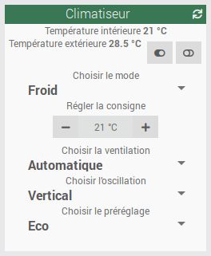
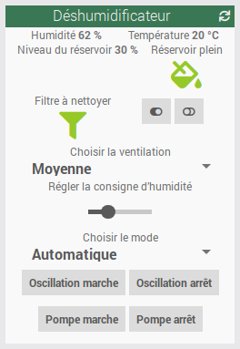
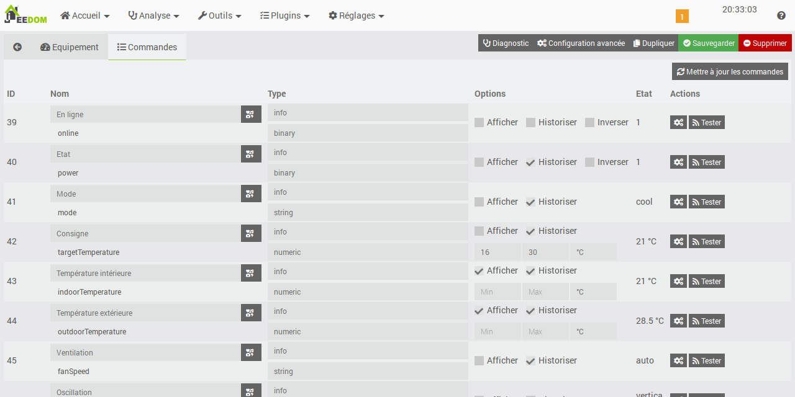
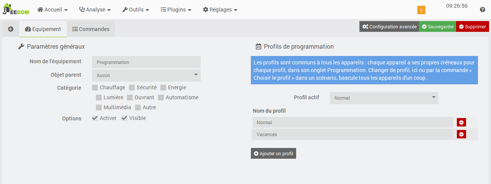
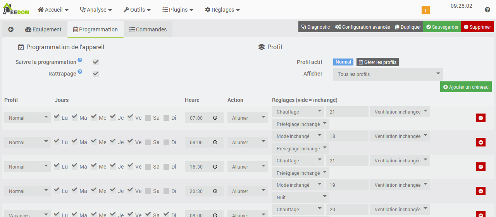
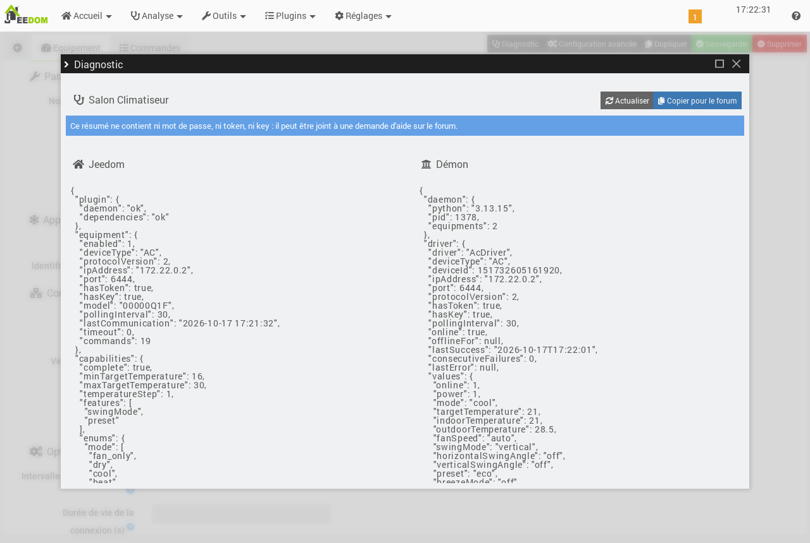

# Плагин Midea MSmart

> **Плагин находится в разработке**: эта документация описывает текущее состояние плагина и будет дополняться с каждой версией.

## Описание

Плагин **Midea MSmart** позволяет **локально** управлять кондиционерами и осушителями Midea и связанных брендов (Comfee, Inventor, Qlima…), совместимыми с приложением **MSmartHome**.

Учётная запись MSmartHome используется только для того, чтобы:

- получить список устройств, привязанных к учётной записи;
- один раз получить ключи аутентификации (*token* и *key*) новых устройств (протокол V3).

После этого все команды и чтение состояния выполняются напрямую через локальную сеть, без облака Midea.

В плагин встроено расписание с профилями, общими для всех устройств (например, *Обычный* и *Каникулы*).

Поддерживаемые устройства:

| Тип | Устройство |
|---|---|
| `0xAC` | Кондиционер (сплит, мобильный, PortaSplit…) |
| `0xCC` | Коммерческий кондиционер |
| `0xA1` | Осушитель |

## Требования

- Jeedom 4.5 или новее, на Debian 12 или 13.
- Устройства и Jeedom должны находиться в **одной локальной сети** (одной подсети), чтобы работал поиск устройств.
- Учётная запись **MSmartHome**, к которой устройства **привязаны напрямую**. Для устройства, к которому лишь *предоставлен доступ* из другой учётной записи, получить ключи невозможно.

> **Совет**
>
> Лучше используйте пароль, состоящий только из букв и цифр.
> После нескольких неудачных попыток входа облако Midea временно блокирует учётную запись, на срок от нескольких минут до 24 часов (ошибки `7610` или `65027`). В этом случае подождите, прежде чем повторить попытку.

## Настройка плагина

После установки включите плагин и запустите установку зависимостей. Плагин устанавливает собственное окружение Python, изолированное от системы.

### Зависимости

Установка зависимостей, запускаемая со страницы настройки плагина, выполняется только в папку плагина:

- автономный **Python 3.13**, загружаемый с помощью инструмента [uv](https://github.com/astral-sh/uv), независимо от версии Python в системе;
- виртуальное окружение (`resources/python_venv`) с библиотеками плагина, в зафиксированных версиях с проверкой контрольных сумм.

Установка занимает несколько минут и около 130 МБ. В 32-битной системе (Raspberry Pi на `armhf`) также устанавливается компилятор, и операция длится дольше, так как одну библиотеку приходится компилировать.

После обновления плагина, меняющего эти версии, зависимости снова переходят в состояние *NOK*: просто перезапустите их установку. Они не входят в резервные копии Jeedom; после восстановления перезапустите их установку.

### Параметры

- **Учётная запись MSmartHome**
  - **Логин (email)** и **Пароль** учётной записи MSmartHome.
- **Локальная сеть**
  - **Широковещательный адрес**: широковещательные адреса для поиска устройств, через запятую. Оставьте пустым (по умолчанию), чтобы использовать все сетевые интерфейсы Jeedom. Если устройства не находятся, укажите широковещательный адрес их сети (например, `192.168.1.255`).
  - **Интервал опроса по умолчанию**: время в секундах между двумя чтениями состояния устройств (по умолчанию 30 с, минимум 10 с).
  - **Время жизни соединений**: кондиционеры переподключаются по истечении этого времени (по умолчанию 90 с). Некоторые устройства через какое-то время сами разрывают соединение, что вызывает ошибки и обрывы: значение меньше этого интервала позволяет их избежать. 0 = соединение сохраняется бессрочно.
- **Демон**
  - **Порт демона**: локальный порт демона (по умолчанию 55114). Изменяйте его только при конфликте с другим плагином.

### Демон

Демон обеспечивает локальную связь с устройствами. После установки зависимостей он запускается автоматически (если включено автоматическое управление) или кнопкой **(Пере)запустить** на странице настройки плагина.

- Он слушает только на машине Jeedom (`127.0.0.1`), на указанном выше порту.
- При запуске он **никогда** не подключается к облаку Midea, что исключает блокировку учётной записи.
- Его сообщения записываются в журнал `mideamsmart_daemon`, а сообщения установки зависимостей — в `mideamsmart_update`. Установите уровень журнала плагина *Debug*, чтобы видеть подробности обмена. Плагин скрывает в нём пароли, *token* и *key*.

## Добавление устройств

На странице плагина кнопка **Синхронизировать** (демон должен быть запущен):

1. ищет устройства в локальной сети;
2. если настроена учётная запись MSmartHome, подключается к ней и получает список устройств учётной записи;
3. для каждого устройства V3, ключи которого ещё неизвестны, получает *token* и *key* из облака, затем **проверяет их непосредственно на устройстве** перед сохранением;
4. создаёт новое оборудование или обновляет IP-адрес, порт и протокол существующего. Имена и уже сохранённые ключи никогда не изменяются.

Сообщение подводит итог и указывает устройства, для которых не удалось получить ключи. Устройства неподдерживаемого типа пропускаются. Без учётной записи MSmartHome выполняется только локальный поиск.

Кнопка **Добавить** позволяет создать оборудование вручную, например для устройства в другой подсети. В этом случае нужно самостоятельно указать идентификатор, IP-адрес и, для устройства V3, *token* и *key*.

## Оборудование

- **Устройство Midea**
  - **Тип устройства**: кондиционер, коммерческий кондиционер или осушитель.
  - **Идентификатор устройства**: идентификатор Midea, заполняется автоматически при синхронизации.
- **Локальное подключение**
  - **IP-адрес** и **Порт** (по умолчанию 6444).
  - **Версия протокола**: V3 для большинства новых устройств, V2 для более старых.
  - **Token** и **Key**: ключи аутентификации устройств V3, получаются автоматически.
  - **Получить token/key из облака**: повторно запрашивает в облаке ключи этого устройства и проверяет их, например после сброса Wi-Fi-модуля. Перед использованием сохраните оборудование.
- **Параметры**
  - **Интервал опроса**: оставьте пустым, чтобы использовать значение из настроек плагина.
  - **Время жизни соединения** (кондиционеры): оставьте пустым, чтобы использовать значение из настроек плагина.
  - **Звуковое подтверждение**: устройство подаёт сигнал при каждой полученной команде.
  - **Шаг уставки** (кондиционеры): 1 °C или 0,5 °C.
  - **Энергопотребление** (кондиционеры): создаёт команды мощности и потребления. Если значения некорректны, измените **формат** (BCD или двоичный) или **коэффициент масштаба**.
- **Информация**
  - Серийный номер и модель устройства, только для чтения.
  - **Возможности**: *Получены от устройства* или *По умолчанию*, если устройство их ещё не передало. В этом случае они запрашиваются повторно автоматически, а команды корректируются сразу после получения.

> **Важно**
>
> Храните *token* и *key* ваших устройств V3 в надёжном месте. Они позволяют продолжать управлять устройствами, даже если облако Midea станет недоступно.

## Команды

 

Команды создаются автоматически **в соответствии с возможностями, которые сообщает каждое устройство**, как только оно впервые отвечает. Если устройство не сообщает свои возможности, используются возможности по умолчанию, а запрос повторяется через 30 секунд, затем с растущими интервалами до 10 минут. После их получения команды корректируются автоматически.

Текстовые информационные команды содержат **стабильный код**, не зависящий от языка (например, `cool`): используйте эти коды в сценариях. Связанные команды действий показывают переведённые названия. Информация, уже отображаемая связанным действием, по умолчанию скрыта.

Кнопка **Обновить команды** на вкладке *Команды* добавляет недостающие команды, удаляет команды функций, о которых устройство больше не сообщает, и заново считывает его возможности. Имена и настройки существующих команд сохраняются. Команды, которые вы сами добавили к оборудованию (логический идентификатор, неизвестный плагину), никогда не удаляются.

| Логический идентификатор | Устройства | Содержание |
|---|---|---|
| `power`, `on`, `off` | AC, CC, A1 | Состояние (0/1), включить, выключить |
| `mode`, `setMode` | AC, CC | Режим: `auto`, `cool`, `dry`, `smart_dry`, `heat`, `fan_only` (CC: `fan`). Выбор режима включает устройство |
| `targetTemperature`, `setTargetTemperature` | AC, CC | Уставка в °C с ограничениями устройства и шагом, выбранным в оборудовании |
| `indoorTemperature`, `outdoorTemperature` | AC, CC | Температура в помещении и снаружи |
| `fanSpeed`, `setFanSpeed` | AC, CC | Вентилятор: `auto`, `silent`, `low`, `medium`, `high`, `max`, `custom` (CC: от `l1` до `l7`, `auto`) |
| `fanSpeedPercent`, `setFanSpeedPercent` | AC | Произвольная скорость от 1 до 100 %, если устройство её поддерживает |
| `swingMode`, `setSwingMode` | AC, CC | Качание: `off`, `vertical`, `horizontal`, `both` |
| `horizontalSwingAngle`, `verticalSwingAngle` + `set…` | AC, CC | Положение заслонок: `off`/`close`, от `pos_1` до `pos_5`, `auto` |
| `preset`, `setPreset` | AC, CC | Взаимоисключающая предустановка: `none`, `sleep`, `freeze_protection`, `eco`, `ieco`, `turbo` (CC: `none`, `eco`, `silent`, `sleep`) |
| `breezeMode`, `setBreezeMode` | AC | Режим Breeze: `off`, `breeze_away`, `breeze_mild`, `breezeless` |
| `indoorHumidity`, `targetHumidity`, `setTargetHumidity` | AC, CC | Влажность в помещении и уставка влажности (%) |
| `displayOn`, `toggleDisplay` | AC | Состояние дисплея и переключение |
| `purifier`, `purifierOn`, `purifierOff` / `purifierMode`, `setPurifierMode` | AC / CC | Очиститель (AC: вкл./выкл.; CC: `off`, `on`, `auto`) |
| `flash`, `outSilent`, `cascadeMode`, `freshAirFanSpeed`, `rateSelect`, `auxMode` + actions | AC (CC : `auxMode`) | Расширенные функции в зависимости от модели |
| `selfCleanActive`, `startSelfClean`, `filterAlert`, `defrostActive`, `errorCode` | AC | Самоочистка, сигнал фильтра, оттаивание (только если устройство его сообщает), код ошибки |
| `realTimePower`, `currentEnergy`, `totalEnergy` | AC | Мощность (Вт) и потребление (кВт·ч), если включён параметр *Энергопотребление* |
| `mode`, `setMode` | A1 | Режим: `manual`, `continuous`, `auto`, `clothes_dry`, `shoes_dry`, `silent`. Выбор режима включает устройство |
| `fanSpeed`, `setFanSpeed` | A1 | Вентилятор: `lowest`, `low`, `medium`, `high`, `auto` |
| `currentHumidity`, `currentTemperature`, `targetHumidity`, `setTargetHumidity` | A1 | Влажность и температура в помещении, уставка влажности от 35 до 85 % |
| `tankLevel`, `tankFull`, `waterLevelSet`, `setWaterLevelSet` | A1 | Уровень резервуара (%), резервуар полон, порог резервуара (`25`, `50`, `75`, `100`) |
| `swing`, `childLock`, `anion`, `pump` + `…On`, `…Off` | A1 | Качание, защита от детей, ионизатор, насос (если есть) |
| `filterCleaningReminder`, `resetFilter` | A1 | Напоминание о чистке фильтра и его сброс |
| `online`, `refresh` | AC, CC, A1 | Доступность устройства (0/1) и немедленное обновление |
| `scheduleEnabled`, `scheduleOn`, `scheduleOff` | AC, CC, A1 | Расписание включено (0/1), включение и приостановка расписания устройства |
| `profile`, `setProfile` | Расписание | Имя активного профиля и выбор профиля (идентификатор или имя) |

## Расписание

Плагин может управлять устройствами по расписанию, например с одной программой на учебный период и другой на каникулы. Всё происходит в Jeedom, локально. Программы приложения MSmartHome недоступны из локальной сети: отключите их, чтобы избежать конфликтов.

### Общие профили

Плитка **Расписание** на странице плагина открывает оборудование *Расписание*, создаваемое автоматически. Оно содержит **профили**, общие для всех устройств (по умолчанию *Обычный* и *Каникулы*):

- добавляйте, переименовывайте и удаляйте профили, затем сохраните;
- выберите **активный профиль** здесь или командой действия *Выбрать профиль* (`setProfile`), например в сценарии, запускаемом в начале и в конце каникул. Команда принимает и имя профиля;
- информационная команда *Профиль* (`profile`) содержит имя активного профиля;
- отключение оборудования *Расписание* приостанавливает расписание всех устройств.

### Интервалы каждого устройства

Вкладка **Расписание** каждого устройства содержит его интервалы. Интервал включает:

- профиль, дни и время;
- действие: **Включить** или **Выключить**;
- для *Включить* — необязательные настройки: режим, уставка, вентиляция и предустановка (например, *Ночной*) для кондиционера; режим, влажность и вентиляция для осушителя. Пустая настройка не меняется, а выбор режима включает устройство.

Применяются только интервалы активного профиля. Список **Показать** фильтрует таблицу по профилю, а новый интервал добавляется в показанный профиль.

Параметры устройства:

- **Следовать расписанию**: устройство применяет свои интервалы. Команды *Следовать расписанию* (`scheduleOn`) и *Приостановить расписание* (`scheduleOff`) делают то же самое из сценария, а информация *Расписание включено* (`scheduleEnabled`) показывает состояние;
- **Навёрстывание** (включено по умолчанию): при смене профиля, возобновлении расписания или перезапуске Jeedom последний прошедший интервал применяется сразу, не дожидаясь следующего. Например, при переходе на *Каникулы* в 10:00 кондиционер принимает состояние интервала 8:00 профиля *Каникулы*.

Полезно знать:

- интервалы проверяются каждую минуту задачей *cron* плагина, которая должна оставаться включённой в настройках плагина;
- ручная настройка (пульт, виджет, сценарий) сохраняется до следующего интервала;
- добавление или изменение интервала ничего не применяет сразу: следующий интервал применяется в своё время.

Пример для кондиционера в учебный период и на каникулах:

| Профиль | Дни | Время | Действие |
|---|---|---|---|
| Обычный | Пн–Пт | 07:00 | Включить, Обогрев, 21 °C |
| Обычный | Пн–Пт | 08:00 | Включить, 18 °C |
| Обычный | Пн–Пт | 16:30 | Включить, Обогрев, 21 °C |
| Обычный | Пн–Пт | 20:30 | Включить, 19 °C, предустановка Ночной |
| Каникулы | Пн–Вс | 08:00 | Включить, Обогрев, 20 °C |
| Каникулы | Пн–Вс | 21:00 | Выключить |

## Диагностика и надёжность

- **Диагностика** (кнопка вверху страницы оборудования): показывает настройки, видимые Jeedom, и состояние, видимое демоном (подключение, последний ответ, последняя ошибка, исходные возможности и значения устройства). Кнопка **Скопировать для форума** копирует эту сводку без паролей, *token* и *key*, готовую для вставки в запрос помощи на [форуме Jeedom](https://community.jeedom.com).
- **Устройство недоступно**: команда `online` переходит в 0, а оборудование отмечается в Jeedom как *timeout*. Опросы постепенно становятся реже, вплоть до одного раза в 5 минут, и возвращаются к обычному ритму, как только устройство отвечает.
- **Смена IP-адреса**: если устройство не отвечает 5 минут, демон ищет его в локальной сети (не чаще одного раза в 10 минут, без облака). Если оно найдено по другому адресу, IP-адрес оборудования обновляется автоматически. Тем не менее рекомендуется закрепить адреса устройств в роутере.
- **Защита учётной записи MSmartHome**: блокировка облака (коды `7610`, `65027`) или отклонённый пароль запоминаются даже после перезапуска демона. Во время блокировки синхронизация ограничивается локальной сетью, а получение ключей запрещено. Отклонённый пароль больше не используется, пока его не изменят.
- **Страница «Здоровье»** Jeedom: показывает число доступных устройств и состояние учётной записи MSmartHome.

## Устранение неполадок

| Сообщение | Решение |
|---|---|
| *Network error … Transport is closing or closed* (warning) | Устройство разорвало соединение: плагин переподключается и сразу повторяет запрос. Если сообщение появляется часто, уменьшите **время жизни соединений** (например, до 60 с). |
| *Payload … failed CRC and checksum* (warning) | Некорректный кадр, пропущенный библиотекой, часто связан с обрывами соединения: решение то же, что выше. |
| Лишние команды или разные команды у одинаковых устройств | Возможности не были получены (индикатор *Возможности* оборудования): они запрашиваются повторно автоматически. Можно также нажать **Обновить команды**. |
| *Неверный логин или пароль MSmartHome* | Проверьте учётную запись в настройках плагина. Плагин не повторяет попытку, пока учётные данные не изменятся. |
| *Облако Midea временно заблокировало учётную запись* | Слишком много подключений (коды `7610`, `65027`). Подождите указанное время, не запуская новую синхронизацию. |
| *устройство не привязано напрямую к этой учётной записи (общий доступ?)* | В приложении MSmartHome привяжите устройство к этой учётной записи, а не только через общий доступ. |
| *устройство отсутствует в учётной записи MSmartHome* | Устройство есть в сети, но в другой учётной записи: введите *token* и *key* вручную или привяжите его к этой учётной записи. |
| *ключи отклонены устройством* | Повторите **Получить token/key из облака**; если проблема сохраняется, заново привяжите устройство в приложении. |
| *устройство не найдено в локальной сети* / *недоступно* | Убедитесь, что устройство включено и находится в той же сети, что и Jeedom, или укажите **широковещательный адрес** его сети. |

## Благодарности

Плагин основан на библиотеках с открытым исходным кодом [msmart-ng](https://github.com/mill1000/midea-msmart) и [midea-local](https://github.com/midea-lan/midea-local).

Плагин задуман и направляется **ddelec24** (дирижёр проекта) и разработан совместно с **Claude** (Anthropic), соавтором кода и документации.
