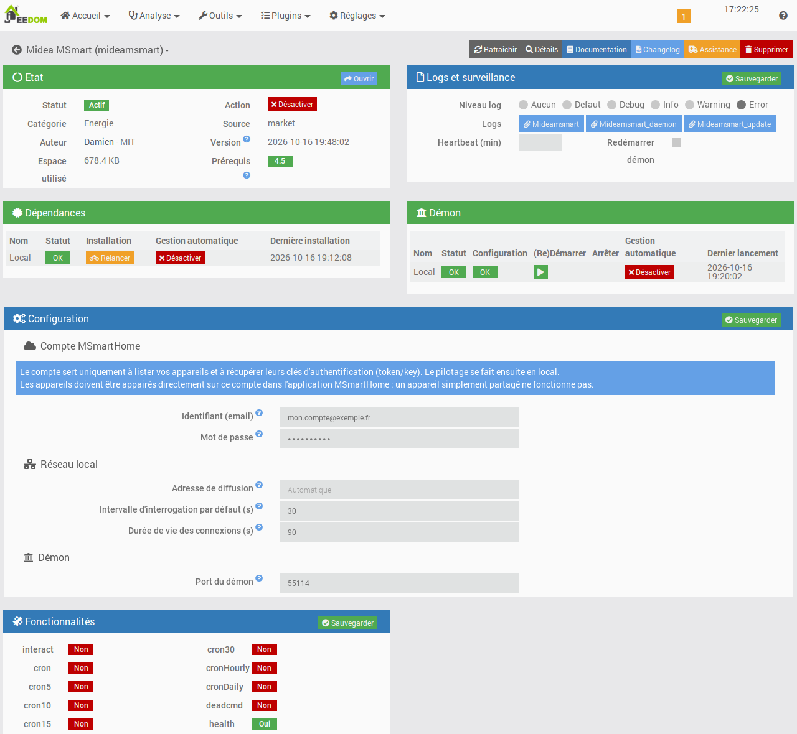
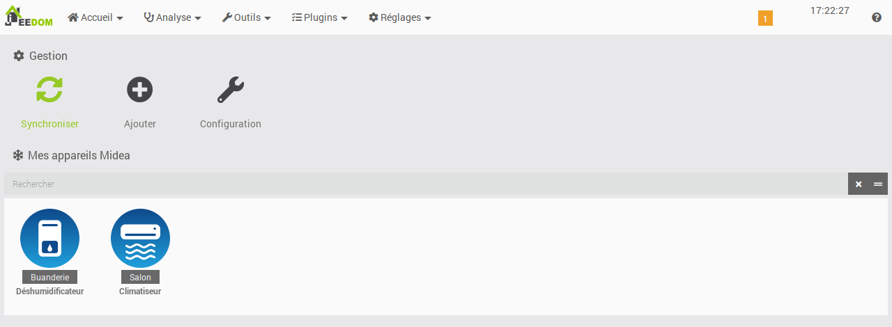
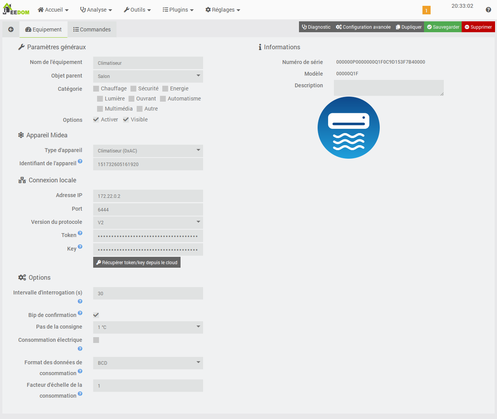

# Плагин Midea MSmart

> **Плагин находится в разработке**: эта документация описывает текущее состояние плагина и будет дополняться с каждой версией.

## Описание

Плагин **Midea MSmart** позволяет **локально** управлять кондиционерами и осушителями Midea и связанных брендов (Comfee, Inventor, Qlima…), совместимыми с приложением **MSmartHome**.

Учётная запись MSmartHome используется только для того, чтобы:

- получить список устройств, привязанных к учётной записи;
- один раз получить ключи аутентификации (*token* и *key*) новых устройств (протокол V3).

После этого все команды и чтение состояния выполняются напрямую через локальную сеть, без облака Midea.

Поддерживаемые устройства:

| Тип | Устройство |
|---|---|
| `0xAC` | Кондиционер (сплит, мобильный, PortaSplit…) |
| `0xCC` | Коммерческий кондиционер |
| `0xA1` | Осушитель |

## Требования

- Jeedom 4.5 или новее, на Debian 12 или 13.
- Устройства и Jeedom должны находиться в **одной локальной сети** (одной подсети), чтобы работал поиск устройств.
- Учётная запись **MSmartHome**, к которой устройства **привязаны напрямую**. Для устройства, к которому лишь *предоставлен доступ* из другой учётной записи, получить ключи невозможно.

> **Совет**
>
> Лучше используйте пароль, состоящий только из букв и цифр.
> После нескольких неудачных попыток входа облако Midea временно блокирует учётную запись, на срок от нескольких минут до 24 часов (ошибки `7610` или `65027`). В этом случае подождите, прежде чем повторить попытку.

## Настройка плагина

После установки включите плагин и запустите установку зависимостей. Плагин устанавливает собственное окружение Python, изолированное от системы.

- **Учётная запись MSmartHome**
  - **Логин (email)** и **Пароль** учётной записи MSmartHome.
- **Локальная сеть**
  - **Широковещательный адрес**: широковещательные адреса для поиска устройств, через запятую. Значение по умолчанию `255.255.255.255` подходит в большинстве случаев. Если устройства не находятся, укажите широковещательный адрес вашей сети (например, `192.168.1.255`).
  - **Интервал опроса по умолчанию**: время в секундах между двумя чтениями состояния устройств (по умолчанию 30 с, минимум 10 с).
- **Демон**
  - **Порт демона**: локальный порт демона (по умолчанию 55114). Изменяйте его только при конфликте с другим плагином.

## Добавление устройств

На странице плагина кнопка **Синхронизировать** получает устройства учётной записи MSmartHome, ищет их в локальной сети и создаёт соответствующее оборудование.

Кнопка **Добавить** позволяет создать оборудование вручную, например для устройства в другой подсети. В этом случае нужно самостоятельно указать идентификатор, IP-адрес и, для устройства V3, *token* и *key*.

## Оборудование

- **Устройство Midea**
  - **Тип устройства**: кондиционер, коммерческий кондиционер или осушитель.
  - **Идентификатор устройства**: идентификатор Midea, заполняется автоматически при синхронизации.
- **Локальное подключение**
  - **IP-адрес** и **Порт** (по умолчанию 6444).
  - **Версия протокола**: V3 для большинства новых устройств, V2 для более старых.
  - **Token** и **Key**: ключи аутентификации устройств V3, получаются автоматически.
- **Параметры**
  - **Интервал опроса**: оставьте пустым, чтобы использовать значение из настроек плагина.
- **Информация**
  - Серийный номер и модель устройства, только для чтения.

> **Важно**
>
> Храните *token* и *key* ваших устройств V3 в надёжном месте. Они позволяют продолжать управлять устройствами, даже если облако Midea станет недоступно.

## Команды

Команды создаются автоматически в соответствии с возможностями, которые сообщает каждое устройство. Их подробный список будет добавлен сюда, как только они станут доступны.

## Благодарности

Плагин основан на библиотеках с открытым исходным кодом [msmart-ng](https://github.com/mill1000/midea-msmart) и [midea-local](https://github.com/midea-lan/midea-local).
